<!-- SPDX-License-Identifier: AGPL-3.0-only -->
# TMAR Scan Desktop

**An open-source ScanRuler fork with modular Zebra analysis, local notes and navigation, category-scoped feature multi-selection, workspace labels and unified CAD-body export. A Windows/macOS desktop application is planned separately.**

[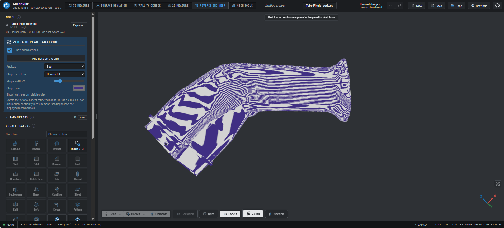](docs/images/zebra-tubo-finale-review-20261102.png)

*Martino's original Zebra screenshot, published unchanged. The file is an imported STL shown as Scan, not a CAD continuity certificate. **Work in progress — user review ongoing; not final acceptance.***

## Screenshot overview

**Click any thumbnail to open the full-size image.** The eleven new UI screenshots
use generated demo geometry in the actual app, with the Dark interface; the real-part
Zebra example above is separately owner-supplied. They illustrate available controls,
not approval of the reconstructed geometry. [Full gallery and captions](docs/tmar-ui-gallery.md).

| Zebra on a real part | CAD edges with Zebra | STEP reference inspection |
| --- | --- | --- |
| [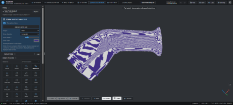](docs/images/zebra-tubo-finale-review-20261102.png) | [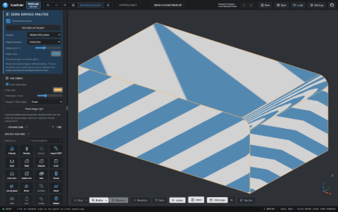](docs/images/ui/cad-edges-zebra.png) | [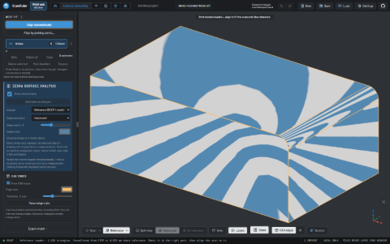](docs/images/ui/step-reference-zebra.png) |

| Category-scoped feature selection | Local notes and Go to note | Workspace label controls |
| --- | --- | --- |
| [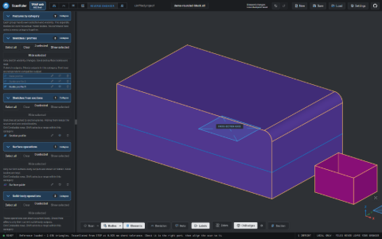](docs/images/ui/feature-categories.png) | [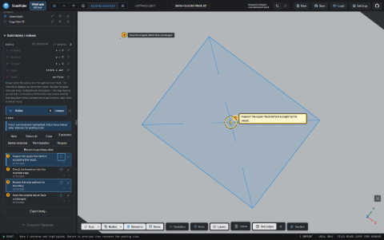](docs/images/ui/notes-focus.png) | [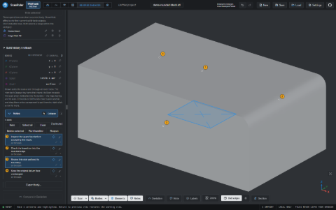](docs/images/ui/label-controls.png) |

| One STEP/STL export dialog | Mesh Tools Zebra inspection | Repeatable regional Smooth |
| --- | --- | --- |
| [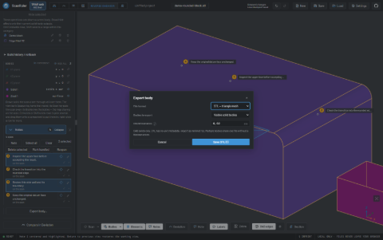](docs/images/ui/unified-export.png) | [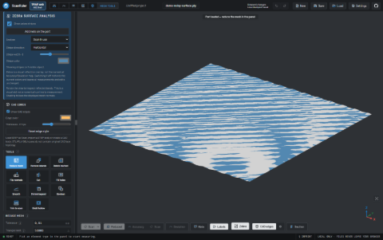](docs/images/ui/mesh-zebra.png) | [](docs/images/ui/regional-smooth.png) |

| Hold Shift to navigate | Dark by default | Review workflow settings |
| --- | --- | --- |
| [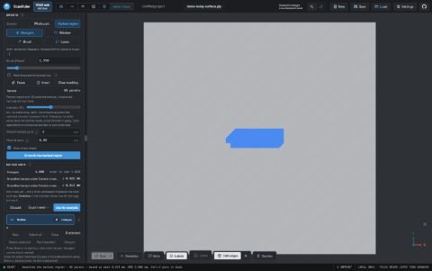](docs/images/ui/shift-navigation.png) | [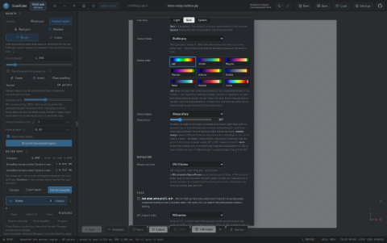](docs/images/ui/dark-settings.png) | [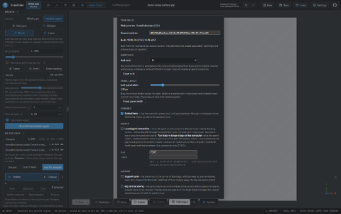](docs/images/ui/review-settings.png) |

## Default appearance

**Dark is the default**, from the first paint, regardless of the operating system's
light/dark setting. An explicit saved **Light**, **Dark** or **System** choice is
still respected. Change it in **Settings > Appearance > Interface**. Existing
previews do not update automatically. [Verification](docs/tmar-dark-gallery-validation.md).

An independent fork of [ScanRuler by CNC Kitchen](https://github.com/CNCKitchen/ScanRuler), maintained at [mrhz1973/tmar-scan-desktop](https://github.com/mrhz1973/tmar-scan-desktop). This is not an official CNC Kitchen distribution.

> **Status as of November 3, 2026: web-source usability extensions implemented.**
> This source includes Zebra, local notes with a configurable shortcut and Go to note, feature/note multi-selection, collapsible lists, lower-bar Labels controls and one Export body dialog for STEP/STL. **No installable desktop release is provided.** The original site and already open previews do not update automatically. Desktop recovery, AI pause/resume, managed updates and GPU compute remain separate goals.

**Documentation language:** English is the primary language of this README. Italian localization of the application and documentation is planned for a later stage; it is not available yet.

[Available now](#web-extensions-available-on-main) | [Body STL](#cad-body-stl-export) | [Status and roadmap](#status-and-roadmap) · [Benefits and limitations](#why-a-desktop-application) · [Updates](#updates-without-manual-builds) · [Multi-selection](#model-tree-multi-selection-and-bulk-actions) · [Quick notes](#quick-notes-on-the-model) · [Deviation notes](#notes-directly-in-deviation) · [Settings and display](#settings-collapsible-panels-and-per-workspace-labels) · [Languages](#languages-and-future-italian-localization) · [Try it today](#how-to-try-it-today) · [Original documentation](README.upstream.md)

## Latest: regional Smooth and Shift navigation

**Marked region only** snapshots the exact selection and never silently falls
back to the whole object. **Smooth whole part** is separately and explicitly
labeled. Smooth retains both the selected area and Brush/Window/Lasso so the next
application needs no extra stroke. Clear marking still removes it deliberately.

Hold **Shift** for temporary Navigate using the current control scheme's normal
left/right mouse functions. Release it to return to the same selection tool;
navigation does not add or erase selected surface.

[Checks and unresolved real-project reproduction](docs/tmar-smooth-brush-validation.md).
User review remains open; this is an updated web build, not a desktop release.

## Latest: Mesh Tools review and repeatable Smooth

**Mesh Tools** now offers local **Note** and **Zebra** controls, shared note
selection/navigation and inspection of the actual scan or edited/reduced preview.
New notes anchor to the scan in use; unsupported preview insertion is explicitly
guarded instead of labeling a different mesh as the target.

**Smooth** keeps a marked region selected after a successful application, so it
can be applied again without reselecting. **Intensity (0–100%)** adjusts the share
of full smoothing; changing the slider alone does not edit geometry. Size, sharp
edge protection and movement limit remain separate. The movement limit is per
application, so repeated passes accumulate. The original scan changes only when
the edited copy is explicitly taken into use.

[Mesh review](plugins/tmar-mesh-review/README.md) |
[Smooth controls](plugins/tmar-smooth-controls/README.md) |
[Actual validation](docs/tmar-mesh-review-validation.md).
**Visual review remains open; this is web source, not a desktop release.**

## Latest: STEP-as-Scan borders and visible TMAR version

**STEP opened as Scan now keeps its CAD face boundaries with Zebra.** The
reported import route is supported without reimporting the file as a CAD body.
The separate **TMAR web + source revision** badge is visible beside ScanRuler;
click it for full build details in Settings. It identifies the loaded bundle,
not the latest repository version. Original ScanRuler version and attribution
are preserved. [Follow-up validation](docs/tmar-step-scan-validation.md).

## CAD face edges with Zebra

Use **CAD edges** on the lower bar in Reverse engineer or single-view Surface
Deviation. **Show CAD edges**, color and 1–6 px thickness are available in the
linked panel. Editable bodies reuse their topology; STEP scans/references retain face
boundaries without internal triangle wireframe. Set **Tangent / fillet edges:
Drawn** for the CAD-body fillet rims. A mesh-only STL cannot supply CAD face topology.

Zebra now also offers the single-view reference target. Notes remain local;
Deviation insertion is still scan-side. [Usage and limits](plugins/tmar-cad-edges/README.md)
| [Actual validation](docs/tmar-cad-edges-validation.md). **User review remains open.**

## Latest: category-scoped feature controls

**Select All / Hide in Sketches no longer acts on the completed body.**
Features are grouped into **Sketches / profiles**, **Sketches from sections**,
**Surface operations**, **Solid-body operations** and **Other features** when
present. Every group has its own large collapse header and selection; known
categories have type-scoped visibility buttons. The native **Bodies** list remains separate; **Build history / rollback**
retains the original chronological controls.

Save Project preserves active feature/note selections. Replacing a project or
Undo/Redo clears transient selections. No geometry or project format is changed.
The model-centred Zebra improvement already integrated by PR #6 is included
unchanged, with its lower-bar button and local notes. Existing previews do not
update when the source changes.

See [category validation](docs/tmar-feature-categories-validation.md) for the
Windows/Chrome checks and limits. This remains a web build, not a desktop release.

## Latest usability follow-up

The saved-note target now receives a large, high-contrast viewport reticle and a
visible navigation message. Hidden or changed CAD references no longer prevent
locating the **saved annotation coordinates**; warnings distinguish that marker
from a verified current surface. Valid stored normals turn the view towards the
annotated surface, without changing geometry or visibility.

**Features** and **Notes** have full-width disclosure headers. Drag the vertical
divider beside the left column to resize it, or use **Settings > Panel layout**.
Width is remembered in this browser. In **Reverse engineer**, the lower **Zebra**
button opens/toggles the analysis without searching through a long feature list.
With only a scan loaded, it selects the scan automatically.

See [the follow-up validation](docs/tmar-note-focus-validation.md) for actual
production-build UI checks and limitations. These changes still do not constitute
a native desktop release.

## Web extensions available on main

These are **implemented web-source features**, not just roadmap entries. They run in the browser without an Electron shell or native installation.

| Extension | Available now | Current boundary |
| --- | --- | --- |
| [Unified CAD body export](plugins/tmar-body-export/README.md) | One **Export body...** button, then STEP/STL, visible/selected body scope and STL chord. | CAD bodies, not the source scan. No automatic Boolean union or manufacturing certificate. |
| [Mesh Tools review](plugins/tmar-mesh-review/README.md) | Local scan notes and Zebra on the displayed scan/edited/reduced mesh; shared note selection and navigation. | Close active editing tools first. Preview note insertion and split view remain guarded. |
| [Repeatable Smooth](plugins/tmar-smooth-controls/README.md) | Retained marked region and 0–100% intensity, persisted settings and per-application Undo. | Marking is transient; repeated per-application movement is cumulative. |
| [Local notes and navigation](plugins/tmar-quick-notes/README.md) | Note button and configurable single-letter shortcut; Ctrl/Cmd/Shift selection; target button/double-click Go to note; previous view; bulk actions. | Deviation placement is scan-side/single-view. CAD-note navigation is in Reverse engineer. No agent connection is required. |
| [Feature-list selection](plugins/tmar-model-tree/README.md) | Independent categorized Ctrl/Cmd/Shift/Select All, type-scoped Show/Hide, large collapse headers and chronological rollback history. | Not batch feature deletion/suppression or an extension of every construction-element list. Unavailable independent outputs are reported. |
| [Workspace display controls](plugins/tmar-display-controls/README.md) | **Labels** on the lower 3D bar; separate note-pin visibility and per-workspace browser preferences. | Advanced category controls in Settings and a separate 2D display policy remain planned. |
| [CAD face edges](plugins/tmar-cad-edges/README.md) | Lower-bar Show CAD edges, color/pixel width, native tangent rims and STEP scan/reference boundaries, compatible with Zebra. | No triangle wireframe substitute, no reference-side note insertion or split-view claim. |
| [TMAR build identification](plugins/tmar-build-info/README.md) | Visible source revision and build details, distinct from upstream ScanRuler. | Identifies the loaded bundle; no automatic update or desktop release. |
| [Zebra](plugins/tmar-zebra/README.md) | Visual analysis of supported scan/CAD targets, adjustable bands and local pinned notes. | Visual aid; not a numerical G1/G2 continuity certificate. Real-part and macOS qualification remain open. |

**Validation:** see [the Brush/Shift follow-up](docs/tmar-smooth-brush-validation.md) for the latest checks and [the Mesh Tools/Smooth record](docs/tmar-mesh-review-validation.md) for its original revision, [the STEP-as-Scan follow-up](docs/tmar-step-scan-validation.md) for its tested revision and [the category record](docs/tmar-feature-categories-validation.md) for its original scope. The [earlier usability record](docs/tmar-usability-validation.md) documents its original revision. The [initial web record](docs/tmar-web-validation.md) remains historical evidence for PR #1; its counts are not a substitute for retesting the new UI. Automated checks use synthetic fixtures and isolated browser profiles; the user-provided screenshot is a separate work-in-progress example, not additional test qualification. No macOS, desktop package, full upstream suite or real-part qualification is claimed.

Use [this fork's web build](#how-to-try-it-today), not `scanruler.com`, to see these controls. Save your active project before opening it in a separate test instance. Existing user sessions are never reloaded by these source changes. No prebuilt desktop package or managed updater is implied.

## Why this fork exists

The goal is to make long reverse-engineering sessions more practical: save work reliably, pause deliberately and resume without reconstructing the operational state from scratch. We also want to follow ScanRuler's frequent updates without requiring users to compile the application or maintain a fork manually.

The chosen direction is **a Windows and macOS application with a desktop shell separate from the ScanRuler web bundle**, together with project-management, update and AI-integration services. Customizations should remain modular wherever possible, so the project can continue benefiting from upstream development.

This project is intended for personal use and community sharing. Modification sources will be public, and future releases should include prebuilt packages, not only source code intended for developers.

## Is this repository right for you?

| Your need | Recommended choice today |
| --- | --- |
| Use ScanRuler immediately without installing anything | Use the [original application](https://scanruler.com/) and its documentation. |
| Use body STL export and scan-side Deviation notes now | Run this fork's web source; see the instructions and explicit limits below. |
| Follow or contribute to a desktop edition with persistent workflow management | The web plugins are already in `main`; the desktop application remains planned. |
| Install a stable TMAR application on Windows or Mac today | No installer is available yet. Wait for an explicitly qualified release. |
| Obtain CUDA or Metal acceleration immediately | Not implemented: this is a later phase, subject to benchmarks. |
| Modify a TMAR extension | The TMAR plugins have dedicated source, English README files and tests. |

## Why a desktop application

**These are benefits we intend to deliver**, not results of an already completed performance comparison.

| Desktop goal | Expected benefit | Limitation to consider |
| --- | --- | --- |
| Dedicated window | Separate CAD work from the browser used for browsing and chat | A desktop window can still crash: verified saving and recovery are necessary. |
| Projects and snapshots on disk | Locate files, retain revisions and recover the last valid state | Backups need testing; autosave cannot prevent every possible loss. |
| Operational pause and resume | Continue from the last completed operation and saved work plan | This does not freeze any arbitrary calculation at its exact internal execution point. |
| Managed updates | Receive verified packages without manual compilation | Incompatible upstream changes may delay a TMAR release. |
| Windows and macOS | Share a workflow and portable project files | Local paths, dependencies and compatibility require validation on both platforms. |
| Resource controls | Make consumption, budgets and compute activity visible | More memory or a GPU does not automatically accelerate every operation. |

Original ScanRuler **already processes scans locally**, saves `.scanruler` projects, and provides browser recovery and MCP integration. These are not inventions of this fork. Our goal is to add desktop management and operational continuity around those capabilities. Inherited documentation is preserved in [README.upstream.md](README.upstream.md).

The planned shell uses Electron: it remains a web engine embedded in an application, not a complete native rewrite of the CAD system. Installation, disk space, shell memory use and security maintenance are trade-offs. **Moving to desktop does not by itself guarantee better speed, geometric accuracy or privacy.**

## Status and roadmap

The source baseline verified for this plan declares **ScanRuler 0.9.4** in [package.json](package.json), at upstream commit [`5c1f2f9`](https://github.com/CNCKitchen/ScanRuler/commit/5c1f2f96b7ac336d5c2bad64148ae19790b0443c). This identifies the inherited baseline, not a TMAR desktop release.

**Status key:** **Implemented in web source** means code is merged and the documented checks exist; it does not mean a desktop installer or hosted deployment exists. **Partial** identifies delivered subfeatures with remaining work. **Planned/assigned** is not an availability claim. PR #1 introduced the first web extensions; PR #3 integrated Zebra at `0b26d51`. This usability increment builds on that baseline. The inherited package version is not a TMAR release identifier; consult the tested commit and validation record.

| Area | Status | Intended outcome |
| --- | --- | --- |
| Public fork and English project overview | Available | Provenance, goals and limitations are visible before choosing the project. |
| ScanRuler web capabilities | Present in inherited source | Measurement, comparison, reverse engineering, mesh tools, projects and MCP; no new desktop qualification is implied. |
| Desktop application | Planned | Windows x64 and macOS Apple Silicon packages, with declared requirements and platform testing. |
| Disk saves and recovery | Planned | Explicit saves, configurable autosave, snapshots and verified restoration. |
| AI workflow pause and resume | Planned | Persistent checkpoints, operation state and reconstruction of operational context. |
| Updates and rollback | Planned | Automated builds and tests, versioned packages, stable/fast channels and safe activation. |
| Resources and backend selection | Planned | Monitoring, RAM/GPU-memory budgets, controlled concurrency and a CPU execution path. |
| GPU computation on Windows and Mac | Later investigation | Evaluate WebGPU and CUDA/Metal modules where a benefit can be demonstrated. |
| Zebra surface analysis plugin | Implemented; user result review ongoing | View-only bands and local notes. The published example is WIP, not final acceptance; broader qualification remains open. |
| [Zebra result review](docs/tmar-review-backlog.md#zebra-review-001) | Open | Record remaining feedback and explicit acceptance separately from feature implementation and screenshot publication. |
| [Split view with Zebra and local notes](docs/tmar-review-backlog.md#zebra-split-002) | Planned | Two-pane review, explicit camera/focus behavior, per-pane labels and shared local note records. |
| [UI screenshot gallery](docs/tmar-ui-gallery.md) | Original WIP Zebra hero and eleven synthetic UI examples published | Clickable thumbnails show implemented changes. Broader real-part validation and final visual acceptance remain open. |
| Model-tree multi-selection and bulk-actions plugin | Implemented, initial feature-list scope | Ctrl/Cmd/Shift/Select All and undoable output visibility. Original body-list selection is retained; broader list coverage and destructive operations remain future work. |
| Quick-note access and navigation plugin | Implemented, initial web scope | Settings-configurable letter (default N), local Note action, note multi-selection, double-click/target Go to note and Return to previous view. |
| Notes directly in Deviation | Implemented in web source; scan-side scope | Add/edit/save notes in the single scan-side comparison view; shared IDs and project round trips verified. Reference-side/split-view anchors and comparison metadata remain planned. |
| CAD body export UI | Implemented in web source | One Export body dialog chooses STEP or STL and visible/selected CAD bodies; adjustable STL chord, no source scan. |
| Collapsible Features and Notes panels | Implemented, initial web scope | Independent header controls, browser-remembered state, preserved selection and note draft. Column width is draggable and configurable in Settings; broader layout presets remain future work. |
| Per-workspace labeling and annotation visibility plugin | Implemented lower-bar controls | Labels and Notes visibility per 3D workspace; no annotation deletion. Advanced Settings categories remain planned. |
| Italian application and documentation localization | Planned for a later stage | An English-first project with translatable UI strings, a selectable Italian interface and maintained Italian documentation. |
| Customizations and contributions | Partial | Six TMAR plugins with English documentation and reusable host hooks. Dynamic package management and automated upstream updates remain planned. |

There are two tracks: **web plugins can be implemented and used now**, independently of the desktop shell; the desktop track remains **shell -> persistence and recovery -> pause/resume -> verified updates -> measured optimization**. Follow-up work includes reference/split-view notes, captured comparison metadata, richer Settings categories, generalized construction-list actions and broader platform/real-part qualification. Tasks can proceed in isolated branches; reliability takes priority over speed. This README does not set delivery dates.

## Saves, pause and resume

Projects should support disk saves with periodic snapshots and checkpoints before critical operations. Writes must avoid replacing the last valid copy with an incomplete save and must handle failures such as a full disk or an unexpected shutdown.

Saving an AI workflow requires more than the model: its goal, requirements, notes, completed operations, outstanding work, performed checks and component versions must also be retained. Resuming must verify the project's actual state before issuing further commands, avoiding duplicate operations.

**The initial pause mechanism will stop between safe operations.** A running geometric calculation may need to finish, or be cancelled and repeated from the last checkpoint. Arbitrary resumption at an internal instruction of a CAD operation is not promised.

A project checkpoint does not automatically preserve a conversation or an AI model's internal memory. It does not remove AI-service limits, network interruptions or the need to start a new agent session. These conditions must be detected and handled explicitly.

Windows/Mac portability does not mean automatic cloud synchronization: project transfer and external-file references need a verified procedure. Uncoordinated concurrent edits to the same project should not be allowed.

## Updates without manual builds

**Approved architecture, not yet implemented:**

1. **Desktop shell:** an initial installation for each platform and independent updates, including security maintenance.
2. **ScanRuler web bundle:** a separately downloadable local version, without rebuilding the entire installer for every upstream change.
3. **Services and native modules:** MCP components, project management and possible GPU backends, versioned and checked together with the web bundle.
4. **GitHub pipeline:** detect upstream releases, integrate customizations, build, test and publish only approved candidates.

Even with several upstream releases in one day, users should not have to follow each one manually. The pipeline may consolidate updates onto the latest candidate. The **stable** channel should favor consolidated versions; the **fast** channel should make versions available sooner after checks pass. Instant upstream-update availability is not guaranteed.

An update must be downloaded and verified without replacing components used by an active job. Activation should happen with the project saved and compatibility checked across the application, MCP, modules and project schema. Packages and manifests must have authenticity and integrity checks rather than come from arbitrary downloads.

**If an update fails checks, the last verified version stays in use.** Projects may pin their working version. Preserve a copy before migration: rolling back the application does not guarantee that an already migrated project will open in an older version.

The goal is offline work with installed components. Update downloads and remote AI services still require connectivity. Users will not need their own fork to use future public packages.

## GPU and memory: optimize where it helps

Using the GPU to display a scene and using it for geometric computation are different things. There is no planned switch that automatically turns the entire CAD system into GPU code.

Performance work will begin with reproducible bottleneck measurements. Initial candidates include distance calculations, deviation maps, nearest-point searches and parts of alignment. We will evaluate WebGPU for cross-platform operations and dedicated **CUDA backends on Windows with NVIDIA** and **Metal backends on macOS Apple Silicon**, retaining a CPU path when a GPU backend is unavailable or not beneficial.

RAM and GPU-memory budgets should guide caches, batch sizes and concurrency. They are not promises of exclusive physical allocation or an automatically enforced hard limit on the entire application. Mac memory management requires its own qualification rather than a copy of settings intended for a discrete Windows GPU.

An optimization will be accepted only after measuring **end-to-end time, memory use, result correctness and failure behavior**. No TMAR benchmarks demonstrating acceleration are available yet. No speed multipliers or automatic accuracy improvements are promised.

## Customization without losing updates

**The TMAR extensions, including `tmar-quick-notes`, `tmar-body-export` and `tmar-zebra`, are separate, community-editable plugins. Future additions follow the same approach**, rather than scattering their implementation throughout the application core. Use existing extension points and keep desktop-shell services in separate modules. Core changes remain possible when required, but must be minimal, justified, documented and covered by tests. See the [upstream plugin architecture](plugins/README.md).

### TMAR plugin requirements

Each extension should make it easy to identify where a change belongs and how to verify it:

| Requirement | Expected outcome |
| --- | --- |
| Dedicated source directory under `plugins/<id>/` | Find plugin logic, UI and resources without searching for scattered core modifications; register through upstream extension points. |
| A README for the plugin | Explain purpose, source layout, development and test instructions, configuration, examples and known limitations. |
| Explicit interfaces and dependencies | Document access to the host and other plugins, supported versions and compatibility; avoid undeclared coupling. |
| Dedicated tests and reproducible cases | Contributors can modify a plugin, verify its behavior and submit a focused pull request. |
| Optional activation and separate state | The rest of the application remains usable without the plugin; saved preferences/data have distinct namespaces and a compatibility strategy. |

The initial model follows upstream plugins included at build time: **a separate directory does not automatically mean hot installation of an external package**. Source changes require rebuilding and testing the affected bundle; the TMAR pipeline should provide prebuilt packages to end users. A manager for independently installable/updatable plugins would need a separate compatibility, authenticity and security design and is not available.

A new upstream version must not erase a customization just to install successfully. If it introduces a conflict or changes an interface, distribution of that candidate must stop until integration is verified. Automation reduces users' manual maintenance; it does not eliminate all project-maintenance work.

General fixes may also be proposed upstream under its contribution rules. A fork does not imply that CNC Kitchen accepts or supports those changes.

## Zebra analysis — initial web plugin

> **User review ongoing - not final acceptance.** The workflow is usable, but
> Martino is still reviewing the result and is not fully satisfied. The example
> below is published as work in progress, not as a final visual or CAD approval.

[View the lead Zebra image and clickable screenshots](#screenshot-overview).

`Tubo Finale-body.stl`, **Analyze: Scan**. This illustrates the current overlay
on an imported mesh, not an editable CAD body being certified. See the
[example gallery and limits](docs/tmar-zebra-examples.md) and
[open review / future split-view backlog](docs/tmar-review-backlog.md).

The initial plugin visually inspects displayed surfaces and their joins, helping identify unwanted waviness and discontinuities. It is a browser rendering aid, not a numerical continuity test or desktop release.

The [tmar-zebra plugin](plugins/tmar-zebra/README.md) uses a removable display layer and an independent analysis slot in Reverse engineer. It supports local pinned notes while active, without enabling an agent connection. The [coordination handoff](docs/tmar-zebra-handoff.md) records its integration boundaries.

- [x] Implement the separate plugin and document its interfaces; the host was smoke-tested with plugins disabled.
- [x] Display zebra stripes on visible or selected CAD bodies, or the scan, with an on/off control.
- [x] Provide adjustable stripe orientation, width and color.
- [ ] Capture views with reproducible parameters for verification reports and AI review.
- [ ] Test reference surfaces with smooth joins, known discontinuities and intentional sharp edges; check tessellation and displayed-normal effects on Windows and macOS.

Zebra analysis must complement, not replace, quantitative CAD/mesh comparison and dimensional/topological checks. A regular-looking display is not by itself proof of geometric continuity or agreement with the real part. Intentional sharp edges must be distinguished from defects.

## Model-tree multi-selection and bulk actions

**Implemented in `tmar-model-tree`: separate category lists, not a mixed global
Select All.** Sketches / profiles, section-based sketches, surface operations,
solid-body operations and unclassified feature types are grouped independently.
Click selects; Ctrl/Cmd toggles rows; Shift and focused Ctrl/Cmd+A are limited to
that category, including off-screen rows. New AI-created rows are not implicitly
added to the selection. Each group and the complete Features area can collapse.

**Sketch Hide keeps all bodies. Surface Hide keeps solids. Solid-operation Hide
keeps surfaces and sketches.** The action rechecks membership and current output
type before changing visibility; stale, suppressed and incompatible outputs are
reported. Shared output body IDs are deduplicated. It is one Undo step, not feature
suppression, deletion or a change to the CAD build order. The separate Bodies list
controls actual body/component selection, including the scope used by Zebra and
CAD export.

**Build history / rollback** keeps native chronological diagnostics and controls;
playback follows that chronology, not category order. Native row edit, delete and
suppression buttons remain explicit actions. Right-click history menus stay in
the original chronological area. Save Project keeps current feature/note selections;
project replacement and Undo/Redo clear them. UI selections are not saved in the
project. Category collapse preferences remain local to this browser.

These groups classify feature records. They do not add saved face selections,
classify every measured construction element or change source-section visibility.
Dependency-safe destructive batch operations and broader construction-element
lists remain future work.

See [plugin usage](plugins/tmar-model-tree/README.md) and
[the category validation](docs/tmar-feature-categories-validation.md).

## CAD body STL export

**The body exporter now has one entry point: Export body...** Choose STEP or STL in the dialog, then visible bodies or an explicit body-list selection, and Save. The historical section title remains for existing links.

STEP retains CAD geometry (including supported sheets); STL triangulates solid CAD bodies through the existing kernel backend. Neither option exports the source scan. The chord field is shown only for STL and follows Settings display units; the file coordinates remain millimetres. Selected components expand to their bodies; empty/stale selections never become export-all. Multiple STL bodies are not automatically Boolean-unioned.

The host's original STEP key is the fallback when no export extension is installed. See [the plugin README](plugins/tmar-body-export/README.md) for scope, validation and limitations.

## Quick notes on the model

**Implemented in `tmar-quick-notes`: local note access, selection and navigation.** No Zebra or agent-connection prerequisite is needed. The existing note data, editor and project records are reused.

**Note -> click the actual surface -> write -> Save.** The Note action is available in the list and on the lower viewport bar. **Settings > Shortcuts > Add note** selects one unmodified A-Z letter or Disabled; the default is **N**, with Reset. Typing, dialogs and active CAD editors retain their keys. Arbitrary modifier combinations are not offered in this first binding UI.

Single-click selects without opening the editor. Ctrl/Cmd adds or removes notes; Shift selects a range; Select All/focused Ctrl/Cmd+A selects the full list. Delete selected requires confirmation and removes only those records; it is not undoable. Mark handled/Reopen applies only to selected notes and preserves imported provenance. Handling a note does not certify a geometry correction.

The pencil opens editing/answering; the target button locates; the check and X keep separate meanings. Collapsing Notes keeps the editor mounted and does not save or discard its draft. Notes are saved with the project, while row selections and focus are session-only.

An explicitly connected agent can use the existing note API. Creating or locating local notes never enables an agent, changes credentials or automatically authorizes imported note text. See [the plugin README](plugins/tmar-quick-notes/README.md).

### Notes directly in Deviation

**Implemented for the visible scan-side, single Deviation viewport.** Inspect the map, activate Note, click a mismatch, write and save without switching workspace. The same ID, text, anchor and handled state appear in Reverse engineer and survive project save/reopen.

Placement does not recompute the map or create a measurement pin. Busy operations, surface marking, deformation animation, alignment picking, hidden scans and clipped/missing picks are guarded. Stop those modes before writing a note.

- [x] Local Note/list, configured shortcut, selection and Go to note in the supported view.
- [x] Shared records and project persistence; no automatic agent connection.
- [ ] Generic reference/CAD-side and split-view placement.
- [ ] Optional captured deviation value, tolerance, target/revision and explicit stale-context refresh. Missing readings must never be inferred from colors.
- [ ] Native macOS and real-part qualification.

See [the implementation limits](plugins/tmar-quick-notes/README.md).

### Locate an existing note on the model

**Implemented: double-click a note row or use its crosshair/target button (Go to note).** The camera frames the saved anchor with surrounding geometry; the corresponding row and marker are highlighted. **Return to previous view** restores the prior target, orientation, zoom and framing. No geometry, note position, text or handled state is changed.

Single-click remains selection; the pencil is editing. With labels or pins hidden, only the focused note is temporarily revealed without modifying saved visibility preferences. Changing workspace or the focused record clears that temporary focus.

A valid saved position remains locatable even when its target is hidden, clipped, removed or changed by rebuilding. Such cases show an explicit warning: the marker is the saved annotation position, not a newly verified surface match. No body is revealed and no anchor is silently remapped. Invalid coordinates, an open editor or conflicting active operations still block navigation with visible feedback. The stored surface normal supplies the viewing direction where available; full occlusion-aware path planning and automatic target remapping remain future work.

The synthetic browser regression exercises 40 notes, long ranges, both navigation entry points, hidden labels, camera return, unchanged drafts and save/reopen. Its exact results are in [the validation record](docs/tmar-usability-validation.md).

## Settings, collapsible panels and per-workspace labels

**Implemented initial web controls:** Note key binding in Settings; independent Features/Notes collapse controls; lower-bar Labels and Notes visibility. The complete advanced Settings design remains a roadmap item.

### Independently collapsible Features and Notes panels

Each list has its own header control and item count. Collapsing retains selection and keeps any note draft mounted. New AI-created rows do not force a list open. Expanded/collapsed state is remembered in this browser. Collapsing changes layout only, not geometry or pin visibility.

The disclosure header spans the full list width and has a large chevron. **Settings > Panel layout** and the draggable vertical divider control column width (260–720 px, constrained to leave model space). Width persists in this browser. Double-click the divider to reset it; arrow keys resize it. Phone layouts remain stacked. Workspace-specific collapse preferences and a general reset-all remain future work.

### Labeling and annotation visibility in each workspace

The **Labels** key on the lower 3D view bar shows/hides text in Reverse engineer, Deviation, Mesh Tools and other supported 3D views. **Notes** controls note markers and their text separately. Reverse retains its existing Notes key; other 3D workspaces receive one while notes exist.

The display plugin remembers label/pin preferences per workspace and browser. Hiding does not delete notes or change their availability to an explicitly connected agent. Hidden pin markers do not intercept clicks. Creating/editing a note can reveal its pins, consistent with the host; Go to note uses a temporary focus instead.

Advanced **Settings > Display** category controls, a global reset and a separate 2D annotation policy remain planned. See [display source and tests](plugins/tmar-display-controls/README.md).

## Languages and future Italian localization

**English README now; Italian application and documentation localization later.** Localization is a planned addition, not a second fork or a separate CAD implementation.

- [ ] Extract user-facing strings into translation resources with stable keys, including labels, tooltips, errors and plugin UI; use English as the fallback.
- [ ] Add an Italian language resource and an in-app language selector, remembering the preference.
- [ ] Let each plugin own its translation resources through a shared localization contract, so contributors can improve wording without changing geometric code.
- [ ] Provide maintained Italian documentation, including a future `README.it.md` linked to the primary English README once it exists.
- [ ] Test longer translated labels, numeric presentation and platform shortcuts. Changing language must not change model units, stored numeric values, object IDs or MCP command identifiers.

Existing developer documentation retains its original language unless explicitly translated. Neither Italian UI support nor a translated README is declared delivered by this roadmap.

## Quality, security and personal data

Before qualifying a desktop release, provide evidence for opening, saving, reopening, STEP export, pause/resume and crash recovery on the declared platforms. Test updates against existing projects and pre-migration snapshots as well.

Geometry changes require tests with declared data, tolerances and results: solid validity, coverage and deviations such as RMS, P95 and maximum where relevant. Comparing CAD with a scan does not by itself certify the real part's accuracy. Tolerances are contextual, not a universal number imposed by this fork.

Public pipelines must use synthetic or shareable fixtures. **Private scans, photographs, credentials, tokens, personal paths and non-anonymized logs must not be published in the repository or test artifacts.**

A desktop application does not make a remote AI service local: what an agent reads may be transmitted to its provider. Agent connections must be explicit and controlled; accounts, models and their costs remain separate from the application. See the [upstream agent privacy warning](README.upstream.md#agents).

## How to try it today

**To use the new TMAR controls, run this fork's web application.** The original [ScanRuler website](https://scanruler.com/) is still an option for upstream-only use, but publishing these changes does not add them to that site. No prebuilt TMAR release or desktop installer is published yet.

With Git and Node.js 22 or later, as declared in [package.json](package.json):

```bash
git clone https://github.com/mrhz1973/tmar-scan-desktop.git
cd tmar-scan-desktop
git switch main
npm ci
npm run dev -- --host 127.0.0.1 --port 5197 --strictPort
```

Open the local address printed by Vite. This explicit port avoids silently selecting an unknown port; choose another unused port if it is occupied. Use a separate browser tab/profile for testing and save active projects before intentionally reloading or replacing their app version. These commands do not update an already running upstream session.

In the fork, use **Reverse engineer > Export body...** and choose STEP or STL. **Note** is available locally in Reverse engineer and scan-side Deviation; its shortcut is in **Settings > Shortcuts** (default N). Double-click a note row or its target icon to locate it. Use Ctrl/Cmd/Shift for list selection and the lower **Labels** control for text visibility. **Reverse engineer > Zebra surface analysis** retains the integrated Zebra tool. Connecting an agent is optional and retains its privacy warning. See each plugin's README for restrictions.

For an existing clone, preserve any local changes and check its branch before updating; do not reset or overwrite an active worktree to follow these instructions. A production web bundle can be built with `npm run build` and served locally with `npm run preview`. This is still a web application, not a desktop package or public deployment.

Development/test details are in [docs/development.md](docs/development.md), and the precise recorded test scope is in [docs/tmar-web-validation.md](docs/tmar-web-validation.md). The complete upstream test suite has not been qualified by the targeted checks. Some tests require additional fixtures or prerequisites.

Future prebuilt packages will appear in [this repository's releases](https://github.com/mrhz1973/tmar-scan-desktop/releases), identifying the upstream baseline, tested platforms, known limits and corresponding source. Desktop signing, distribution and automatic updates remain to be implemented. Windows/Chrome is the recorded test environment, not a declaration of macOS qualification.

## Contributing and references

Suggestions and pull requests are welcome. Describe the concrete problem, desired outcome, effect on upstream updates and required tests. For performance improvements, include hardware, shareable data, timings and correctness checks.

Fork documentation must track releases: a capability moves from **planned** to **available** only with implementation and documented verification. Instructions and workflows in [CONTRIBUTING.md](CONTRIBUTING.md) are inherited from upstream; differences in the TMAR contribution process must be made explicit before applying them to new contributions.

| Reference | Content |
| --- | --- |
| [README.upstream.md](README.upstream.md) | Full copy of the original README at baseline `5c1f2f9`, retained for attribution and documentation; not a list of new TMAR capabilities. |
| [docs/manual.md](docs/manual.md) | Manual for inherited features. |
| [mcp/README.md](mcp/README.md) | Upstream MCP connection and tools. |
| [plugins/README.md](plugins/README.md) | Plugin catalog, upstream extension points and implemented TMAR host hooks. |
| [Body STL plugin](plugins/tmar-body-export/README.md) | Available UI, selection/units rules, source layout and tests. |
| [Deviation notes plugin](plugins/tmar-quick-notes/README.md) | Available scan-side annotation workflow, dependencies and remaining scope. |
| [Web validation](docs/tmar-web-validation.md) | Recorded implementation checks, baseline and explicit qualification limits. |
| [Zebra handoff](docs/tmar-zebra-handoff.md) | Coordination, source baseline, integration boundaries and contribution delivery. |
| [plugins/reverse/README.md](plugins/reverse/README.md) | Inherited Reverse engineer behavior, including existing body-list selection. |
| [docs/development.md](docs/development.md) | Web-baseline development and testing. |
| [CHANGELOG.md](CHANGELOG.md) | Merged TMAR source changes and inherited upstream history; no desktop release is implied. |

## License and acknowledgements

Code derived from ScanRuler remains under **AGPL-3.0-only**; see [LICENSE](LICENSE). Preserve attribution, notices and dependency licenses. The original project is by **CNC Kitchen / Stefan Hermann and its contributors**; TMAR Scan Desktop is an independent initiative.

Future TMAR distributions must make their corresponding source available and comply with dependency obligations, including any GPU components. Commercial licenses described in [COMMERCIAL.md](COMMERCIAL.md) concern the original project's rights holder; they are not a TMAR commercial offering. The personal/community purpose of this fork adds no restrictions to the license.

CNC Kitchen/ScanRuler names and trademarks are not presented as this fork's branding. Original documentation is retained for provenance and reference; the desktop distribution must have its own identity.

---

**Project principle:** preserve work before accelerating it; automate updates without interrupting it; publish only demonstrated benefits, always distinguishing them from future goals.
