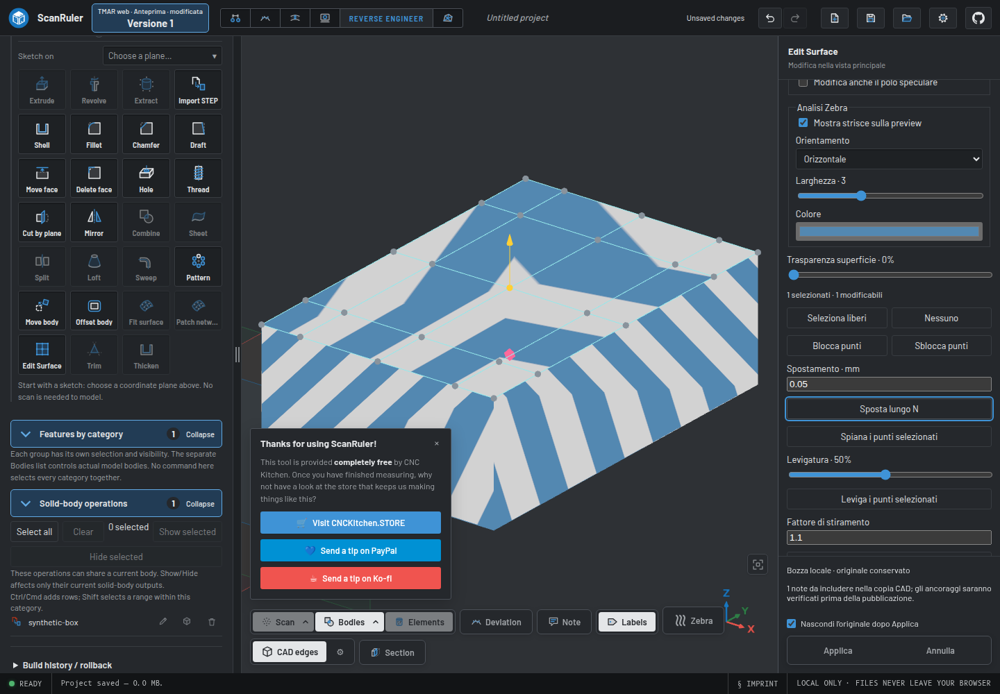
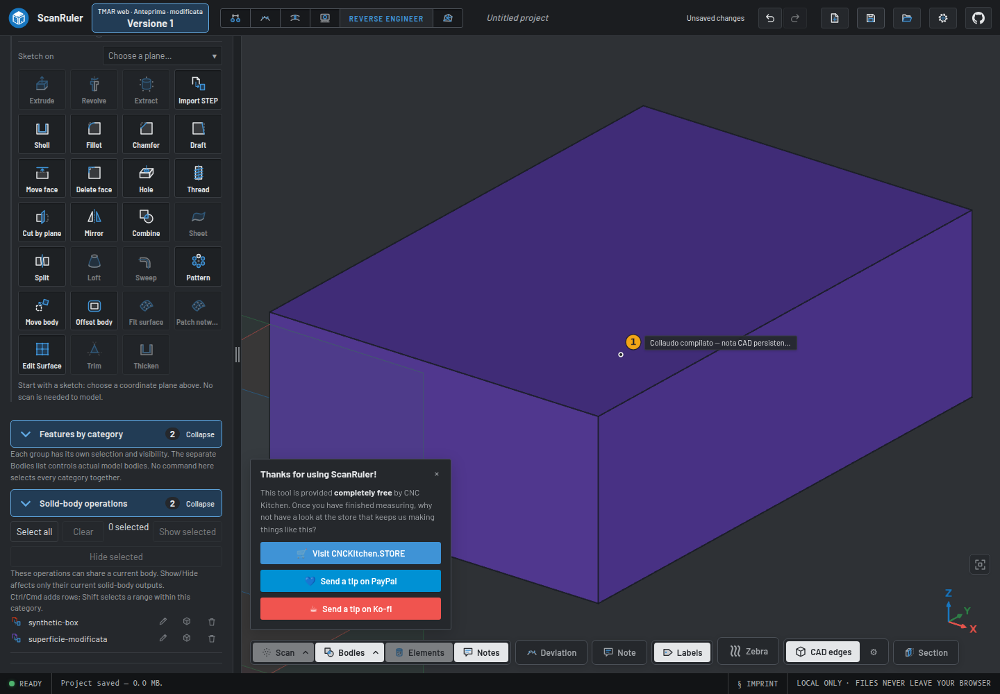
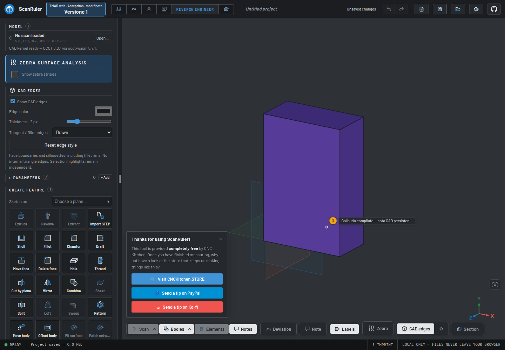

<!-- SPDX-License-Identifier: AGPL-3.0-only -->
# Edit Surface — compiled review gallery

**November 4, 2026. These are actual screenshots from an unmerged review build, not the current hosted app, a new desktop release or mockups.** The model is a synthetic 20 × 30 × 10 mm imported STEP box, not a private project.

Source: [successful Actions run 41747790210](https://github.com/mrhz1973/tmar-scan-desktop/actions/runs/41747790210), artifact `13283244553`. Archive digest and ZIP CRCs were checked. PNGs are copied byte-for-byte, without cropping, retouching or removing the upstream support card.

## 1. Main-viewport editing, Zebra and a draft note

The editor shares the main canvas and adds a right-hand panel. The eligible imported face has a CAD control net, Zebra stripes and a draft note. The shown displacement is **0.05 mm along local N**. It is a feature test, not a scanner-accuracy claim. Draft-note guards prevent an incompatible face switch or a local STEP export from silently dropping the note.

## 2. Applied copy and verified note

Apply creates the modified CAD copy with its note. The original remains in the project but is hidden, avoiding an overlapping display. The test exercises project Undo/Redo as one operation for copy and note. This image shows Apply; the logged checks, not the screenshot alone, verify Undo/Redo.

## 3. Native project reopened

A fresh compiled page opens the saved `.scanruler` file. Camera orientation differs, but test readback checks the note UUID/text, feature and body identity, face binding, coordinates, oriented normal and valid CAD. Both actual exported STEP bodies reimport as valid solids.

## Exact qualification

Runtime **`5f39ff5`**, host **`5684f5f`**, plugin **`324a2e0`**, QA **`0e50b92`**: **155 targeted tests, 15 source-UI checks and 16 compiled-UI checks**, with zero application console errors in these scenarios. [Detailed record](https://github.com/mrhz1973/tmar-scan-desktop/blob/4349ebca42edd43fe685d8d76919a9f18960e588/docs/coordination/integration-host5684-plugin324a2e0-compiled-20261104.md) · [PR #23](https://github.com/mrhz1973/tmar-scan-desktop/pull/23).

The **Versione 1** badge is inherited and is not a new delivery. This does not qualify all production files, arbitrary trims/periodic faces, cylindrical-side editing, global G1/G2 continuity, parametric feature-history persistence, native desktop/macOS packaging or QUICKSURFACE parity. Later author changes have separate evidence.

The full default CI has a separate outstanding browser-stage failure in [PR #24](https://github.com/mrhz1973/tmar-scan-desktop/pull/24); the screenshot tests do not make that workflow green.

[Image hashes and dimensions](images/updates-20261104/manifest.json) · [Existing gallery](tmar-ui-gallery.md) · [README](../README.md)
