<!-- SPDX-License-Identifier: AGPL-3.0-only -->
# TMAR interface gallery

Published **November 3, 2026 (Europe/Rome)**. **User result review remains OPEN.**
The original Zebra hero was supplied by Martino and published with permission on
November 2. It is unchanged. The other eleven images are actual Windows/Chrome UI
captures on generated synthetic parts, source **`08150a0ba2eecb914a91095192ec29e31c55ea64`**; no private model or
live user project was loaded. Full screenshots are 1720 x 1080 pixels. Thumbnails
are 480-pixel-wide downscales, not crops or fabricated interface mock-ups.

Click a thumbnail for the original PNG. Captures show real supported controls,
not a final acceptance statement or numerical geometry/continuity qualification.
The Dark UI is the default. Some examples explicitly use Studio grey shading for
legibility; that is an existing per-view setting, not a change to the default
Scanner blue material.

| Zebra on a real part | CAD edges with Zebra | STEP reference inspection |
| --- | --- | --- |
| [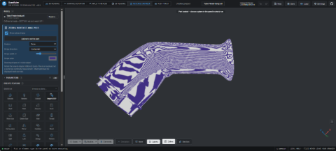](images/zebra-tubo-finale-review-20261102.png) |  | [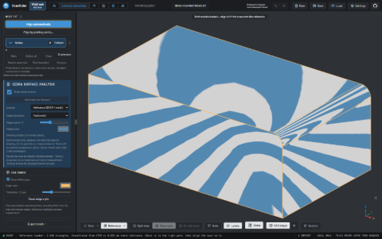](images/ui/step-reference-zebra.png) |

| Category-scoped feature selection | Local notes and Go to note | Workspace label controls |
| --- | --- | --- |
| [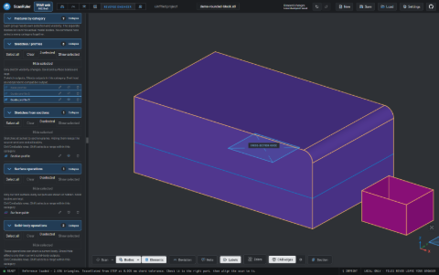](images/ui/feature-categories.png) | [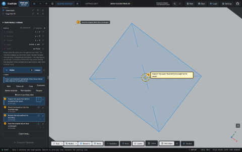](images/ui/notes-focus.png) | [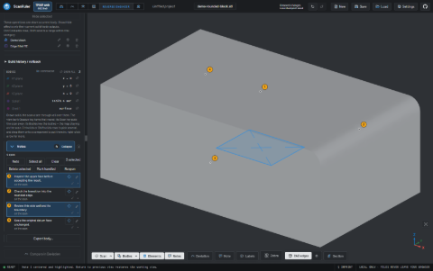](images/ui/label-controls.png) |

| One STEP/STL export dialog | Mesh Tools Zebra inspection | Repeatable regional Smooth |
| --- | --- | --- |
|  | [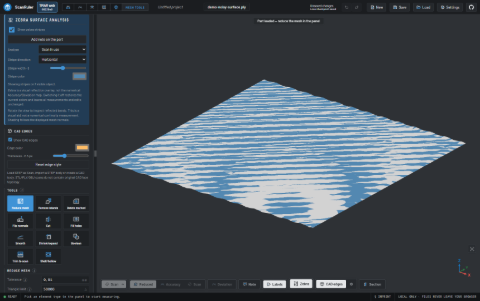](images/ui/mesh-zebra.png) |  |

| Hold Shift to navigate | Dark by default | Review workflow settings |
| --- | --- | --- |
| [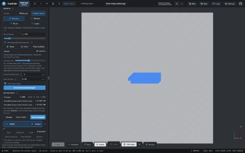](images/ui/shift-navigation.png) | [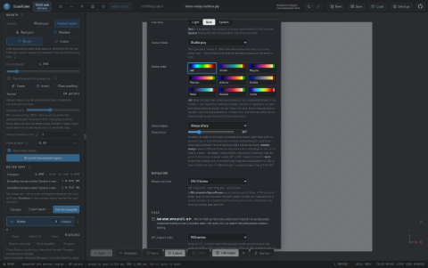](images/ui/dark-settings.png) | [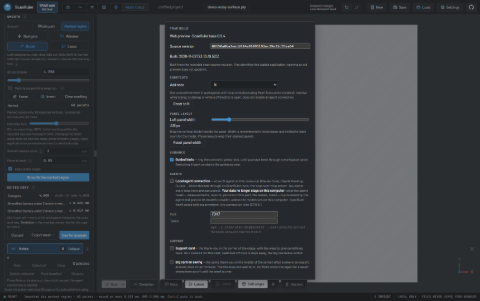](images/ui/review-settings.png) |

## Original real-part Zebra example

[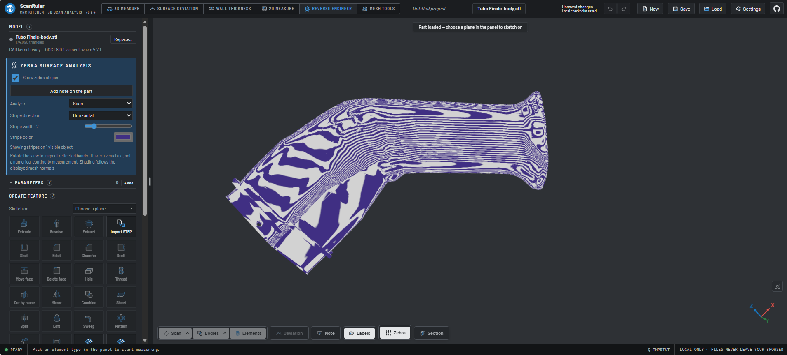](images/zebra-tubo-finale-review-20261102.png)

Imported `Tubo Finale-body.stl`, **Analyze: Scan**. Mesh surface inspection, not an
editable-CAD or general QuickSurface-parity claim. Review remains in progress.

## CAD edges with Zebra

[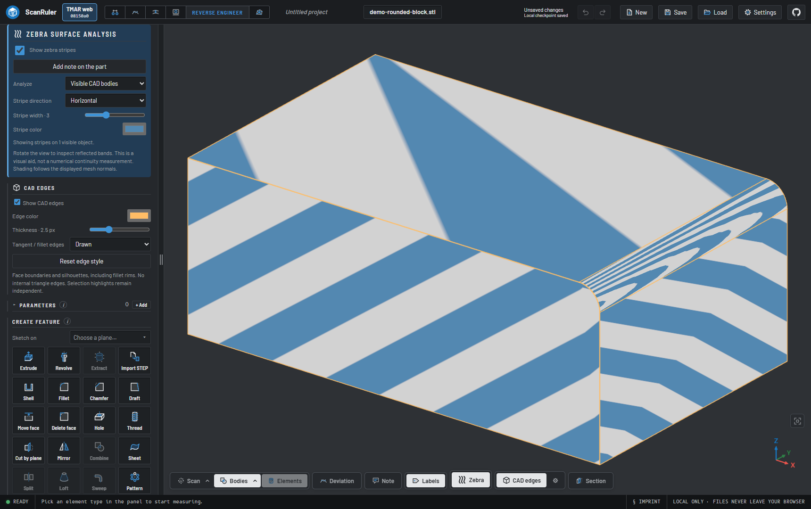](images/ui/cad-edges-zebra.png)

Face and fillet boundaries over reflected stripes on a synthetic CAD block; no triangle wireframe.

## STEP reference inspection

[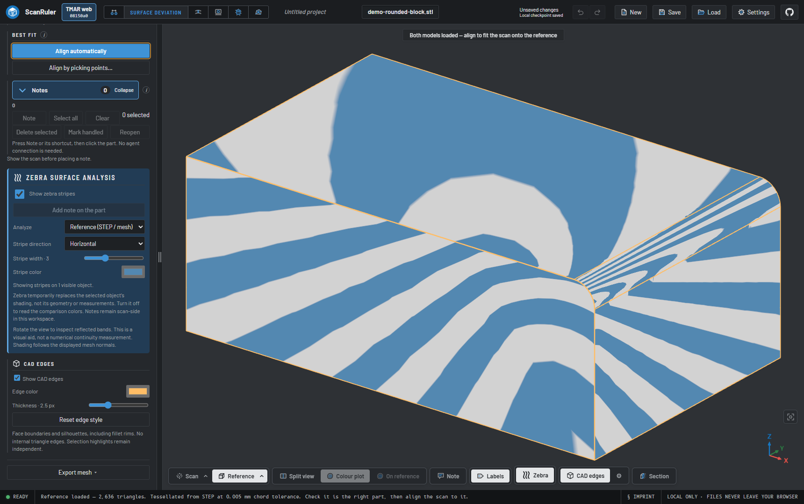](images/ui/step-reference-zebra.png)

Surface Deviation with Zebra and CAD boundaries on a STEP reference; reference-side note placement is not claimed.

## Category-scoped feature selection

[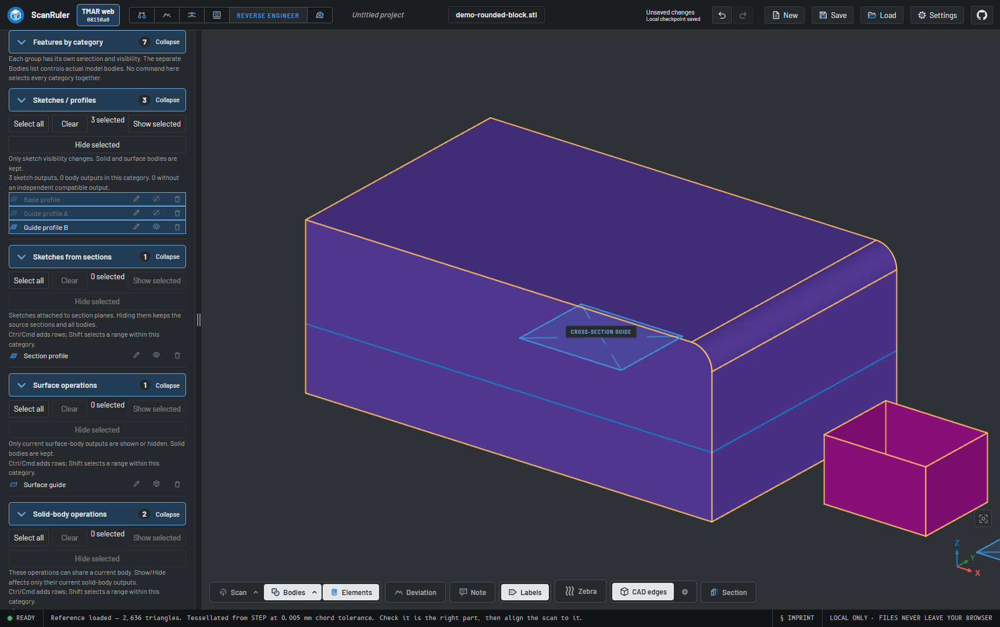](images/ui/feature-categories.png)

Sketches, section profiles, surfaces and solid operations have separate selection and visibility controls.

## Local notes and Go to note

Multi-selection, large collapse header and a visible target reticle for a saved scan note; no agent connection.

## Workspace label controls

[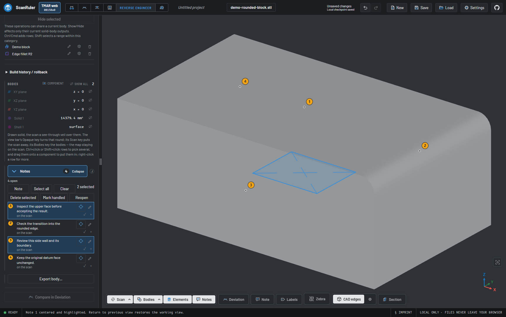](images/ui/label-controls.png)

Text labels hidden with the lower-bar Labels control; saved note records and marker visibility remain independent.

## One STEP/STL export dialog

[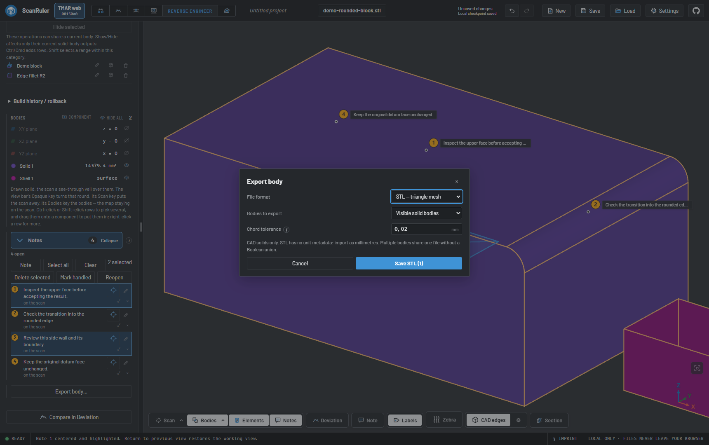](images/ui/unified-export.png)

The same Export body command offers a file-format choice, body scope and STL tessellation tolerance.

## Mesh Tools Zebra inspection

Reflected-stripe inspection on a generated noisy scan; numerical Deviation is a separate tool.

## Repeatable regional Smooth

Two actual Smooth applications at 45% intensity retain the painted area and keep Brush selected.

## Hold Shift to navigate

[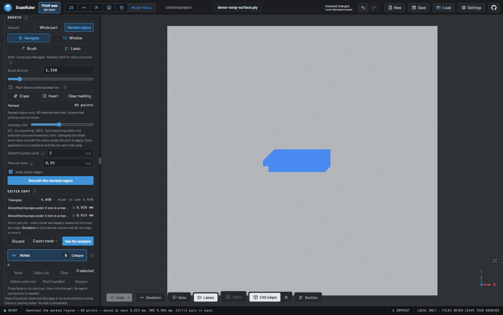](images/ui/shift-navigation.png)

Temporary Navigate feedback while Brush is selected; releasing Shift returns to the same marking tool.

## Dark by default

[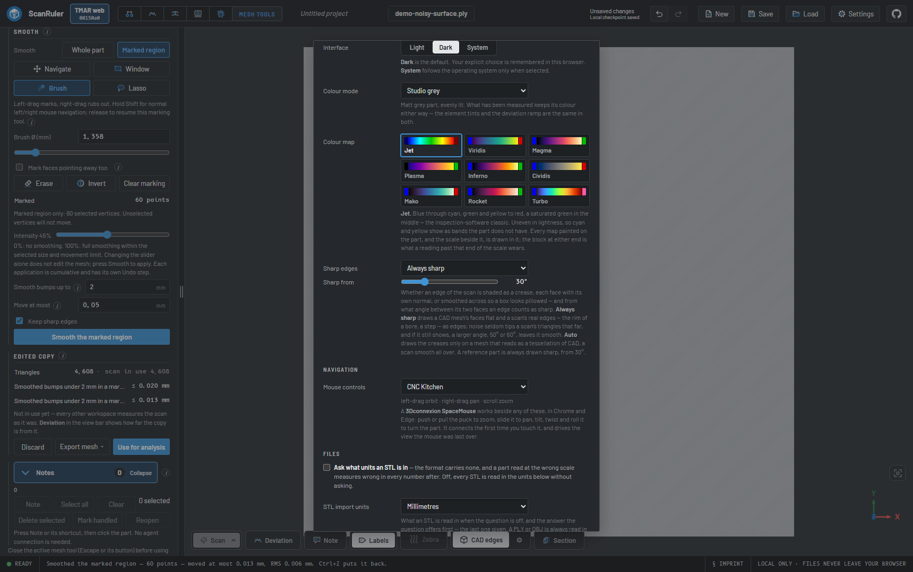](images/ui/dark-settings.png)

The default Dark interface is selected even with a light OS preference. Manual Light and System choices remain available.

## Review workflow settings

[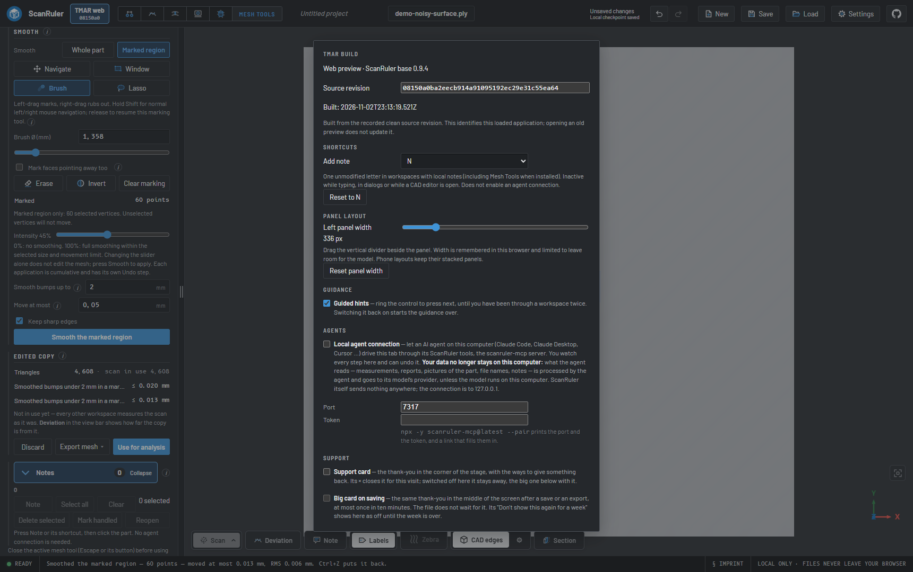](images/ui/review-settings.png)

Configurable Note shortcut, left-panel width and the exact TMAR build identification in Settings.

## Reproduction and limits

Run `node scripts/capture-tmar-gallery.mjs` from a development checkout with the
existing dependencies and Chrome installed. It starts an isolated local server
and a dedicated test profile, generates all geometry and writes to `e2e-out`.
It does not publish images, overwrite the approved hero, open user files or attach
to user sessions. Review screenshots before copying them into documentation.

Mesh preview note insertion, split-view notes, macOS qualification and the user's
reported real-project Smooth issue remain subject to their existing documented
limits. This gallery does not close those review items or announce a desktop release.

[Image provenance](images/README.md) · [Theme checks](tmar-dark-gallery-validation.md)
· [Open review backlog](tmar-review-backlog.md).
