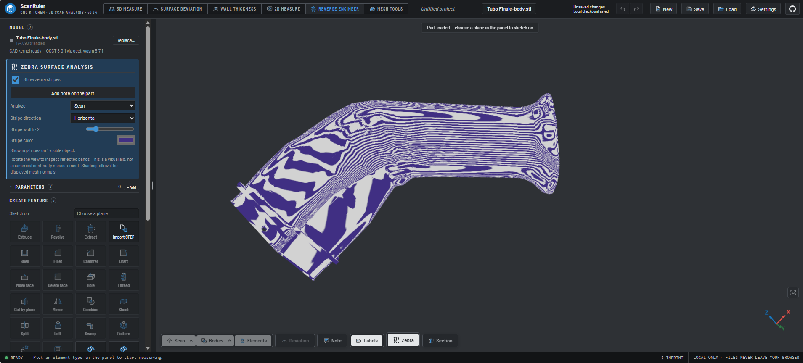

<!-- SPDX-License-Identifier: AGPL-3.0-only -->
# Zebra examples: review in progress

Updated November 2, 2026.

> **Work in progress - user review ongoing; not final acceptance.**
> Martino reports that the workflow is usable, but is still reviewing the result
> and is not fully satisfied. Publishing this example does not close that review,
> approve the visual result, or certify the reconstructed geometry.

## Imported part example: Tubo Finale

Screenshot supplied by Martino and published at his request. The original image
is preserved without cropping, retouching or generated additions. This is a
user-provided workflow illustration, not a new automated validation run.

### What the screenshot shows

| Field | Visible setting |
| --- | --- |
| Workspace | Reverse engineer |
| Loaded filename | `Tubo Finale-body.stl` |
| Zebra target | **Scan** |
| Stripe direction | Horizontal |
| Stripe width | UI level 2 |
| Stripe color | Purple, as shown in the supplied image |
| Application version label | v0.9.4; the exact TMAR commit is not established by this image alone |
| Review status | Ongoing; final visual and geometric acceptance not given |

The STL is being inspected as an **imported mesh**. The word `body` in its
filename does not establish that the displayed object is an editable CAD BRep.
This image demonstrates the overlay being displayed on a non-synthetic part;
it does not establish its dimensional accuracy, topology, G1/G2 continuity,
manufacturability or general equivalence to another application's Zebra analysis.
No source mesh, CAD file, project archive or personal browser data is published.

### Keep evidence and acceptance separate

The existing [synthetic sphere/torus comparison](../plugins/tmar-zebra/evidence/2026-11-02/README.md)
and [category integration validation](tmar-feature-categories-validation.md)
retain their original scope and dates. This screenshot does not expand those
PASS results to a real-part qualification. Areas that still need refinement
will be recorded from subsequent user feedback, rather than inferred as defects
from stripe appearance alone.

## Planned follow-up

[ZEBRA-REVIEW-001](tmar-review-backlog.md#zebra-review-001) keeps the current
review open. [ZEBRA-SPLIT-002](tmar-review-backlog.md#zebra-split-002) records
split view with local notes as future work, not a delivered capability.
[ZEBRA-GALLERY-003](tmar-review-backlog.md#zebra-gallery-003) covers additional
real-part views and comparable before/after examples.

Only the screenshot currently supplied is published here. Additional images
should retain date, available build/target/settings, provenance and an explicit
review status. A future approved image must not retroactively turn this
work-in-progress example into an acceptance record.

[Zebra plugin usage](../plugins/tmar-zebra/README.md) | [Project overview](../README.md)
