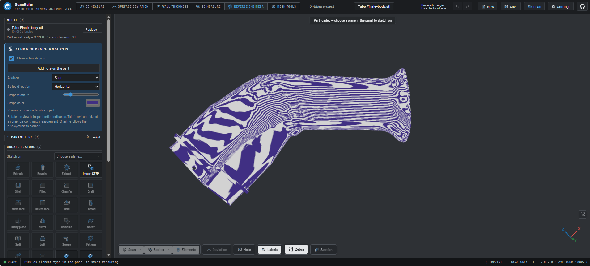

<!-- SPDX-License-Identifier: AGPL-3.0-only -->
# Zebra surface analysis

> **Work in progress - user review ongoing; not final acceptance.**
> The workflow is usable, but the user is still reviewing the result and is not
> fully satisfied. The screenshot below is an illustration, not final visual
> approval, geometric validation or general QS parity.

## Real-part example under review



User-supplied screenshot, November 2, 2026: **Reverse engineer**, imported
`Tubo Finale-body.stl`, **Analyze: Scan**, Horizontal, stripe-width level 2.
The displayed target is a mesh, not a CAD BRep proven by its filename.
[Full example, provenance and limits](../../docs/tmar-zebra-examples.md).

A first **scan-side split-view candidate** is under review in
`feat/web-zebra-split-20261113`: in Surface Deviation's existing linked
split, the left scan may show Zebra while the right reference keeps normal
shading. Notes are placed on the left scan only, using the existing records
and project saves; the right reference cannot receive scan notes. Go to note
centers a visible scan-side note and Return restores the previous linked
camera pose in both viewports; note anchors and geometry remain unchanged. The right
reference cannot yet be Zebra-shaded in split mode, and reference-anchored
notes, resizable layouts and per-pane controls remain future work. **This
candidate is not published in Stable or Dev.** See
[ZEBRA-SPLIT-002](../../docs/tmar-review-backlog.md#zebra-split-002).

Further work includes [real-part gallery views](../../docs/tmar-review-backlog.md#zebra-gallery-003);
the [current Zebra result review](../../docs/tmar-review-backlog.md#zebra-review-001)
remains open and requires operator acceptance.

## Use

In **Reverse engineer**, press **Zebra** in the lower view bar, or open the
highlighted **Zebra surface analysis** panel and check **Show zebra
stripes**. Analyze visible CAD bodies, the bodies selected in the body list, or
the visible scan. Set stripe direction, width and color; rotate the view to
inspect how bands pass over neighboring surfaces. **Add note on the part** pins
a written observation on a body or the scan while stripes remain visible. Notes
are saved with the project and can be used without an agent connection. Turn the switch off to restore
the original appearance. Leaving the workspace also puts the analysis away.

Zebra uses a temporary rendering layer; it does not change, export or save CAD
geometry, scan geometry, materials, body visibility or history. Starting a CAD
editor also closes the analysis. It depends on
the `reverse` plugin and the `reverse.analysis` panel extension. With reverse
disabled, this plugin contributes no controls. A build without this plugin
leaves the host's analysis slot empty.

Reflection coordinates are calculated at the displayed mesh's vertices and
interpolated across each triangle. Coarse tessellation,
scan noise, missing normals, coincident objects and occlusion can change what is
visible. The effect is a qualitative visual aid, not a numeric measurement or
proof of G1/G2 continuity. The comparison map is a different tool. The overlay
is opaque while enabled; the source object's appearance is unchanged and comes
back on exit. The reflection formula and pattern derive from the owner's
SurfaceLab Zebra research. The virtual reflected environment is centred on
the visible inspected geometry: zooming or panning does not move its bands.
Camera rotation does. Selected CAD bodies share the visible CAD frame, so
selecting a subset does not alter the pattern on them.

The November 2 comparison used the same analytical sphere and torus in
QuickSurface/Revo Design and this layer, checking the blue/grey palette,
horizontal/vertical bands and zoom behaviour. See the
[comparison and limits](evidence/2026-11-02/README.md). Exact pixel equality on
arbitrary meshes, tessellations and graphics hardware is not claimed.

The lower button and panel checkbox share one state. Enabling with a scan but
no visible CAD body selects the scan automatically. During a CAD editor the
button remains visible but disabled with an explanation; finish the editor to
resume analysis. The shader/kernel and geometry algorithms are unchanged by
this discoverability update.

## CAD edges and STEP references

The optional [CAD edges plugin](../tmar-cad-edges/README.md) exposes face/fillet
borders and silhouettes while Zebra remains active, with color/pixel width.
The original body Tangent edges setting is reused; triangle mesh mode is separate.

In single-view **Surface Deviation**, Zebra also supports **Reference (STEP / mesh)**.
STEP supplies face-boundary metadata; a mesh-only reference does not. Hide the scan
when inspecting the reference alone. Zebra temporarily covers comparison colors:
turn it off to read the map. Notes in this workspace still attach to a visible scan,
not the reference. The first split-view candidate supports scan-side Zebra and
notes; reference-side notes, picking/alignment and deformation animation remain
guarded.
[Validation and limits](../../docs/tmar-cad-edges-validation.md).

## Checks

```bash
npx vitest run plugins/tmar-zebra/tests/zebra.test.ts
node plugins/tmar-zebra/scripts/e2e-zebra.mjs
node plugins/tmar-zebra/scripts/e2e-zebra-split.mjs
node plugins/tmar-zebra/scripts/check-reflection.mjs
node scripts/check-plugin-boundary.mjs
node scripts/check-units.mjs
```

The browser check uses generated shapes and a fresh, isolated Chrome profile.
It starts a local server unless an explicit `APP_URL` is supplied; never point
it at a user's active session because the scenario replaces its test project.
The app check is registered through `ci.json`. `check-reflection.mjs` isolates
the actual WebGL layer and records camera/frame regressions with screenshots;
`--before` renders the recorded pre-fix revision for comparison (it must be
present in the local Git history). `reference-fixtures.mjs` generates the
small STEP sphere and torus used for manual reference-app checks. Outputs go
to the ignored `e2e-out/zebra-reference` directory.

Windows/Chrome was exercised; a
real scanned part, macOS, a full continuity benchmark and live agent services
remain unqualified. Temporary browser-profile removal can be delayed by
Windows file locks; the check reports a cleanup warning if this occurs.

## Mesh Tools inspection

`tmar-mesh-review` reuses this panel and renderer for the actual scan, edited
copy or reduced preview. Missing reduced-mesh normals are derived on an owned,
flat display copy only. Source meshes and exports are unchanged. Numerical
deviation remains separate. See [Mesh Tools](../tmar-mesh-review/README.md).
