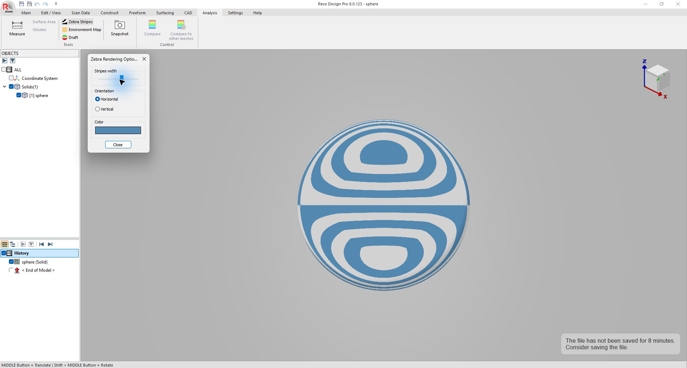
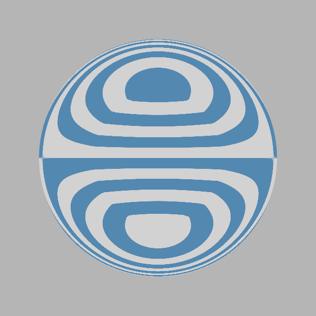
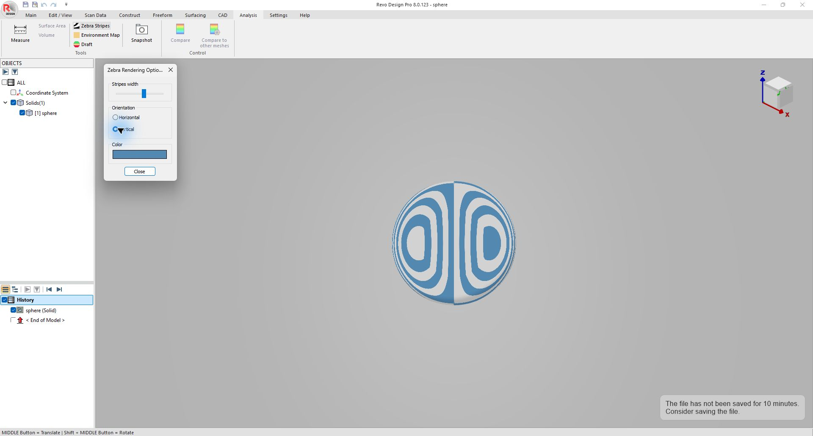
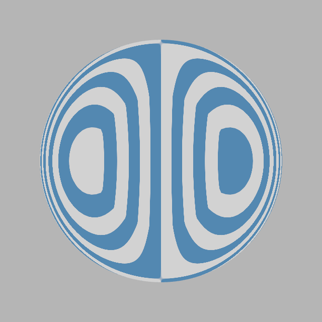
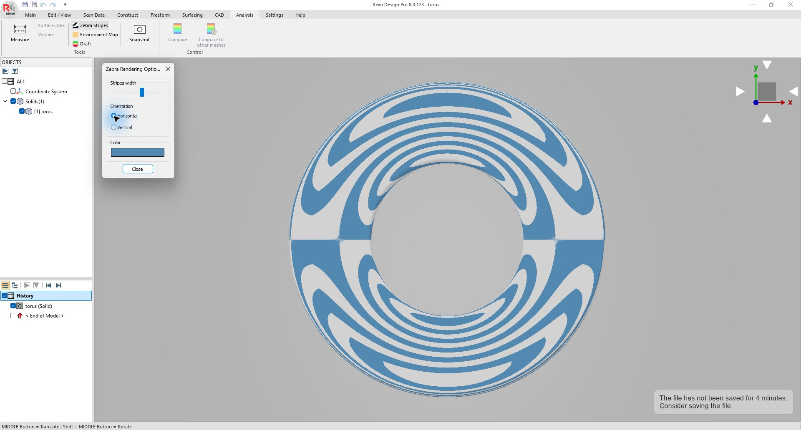
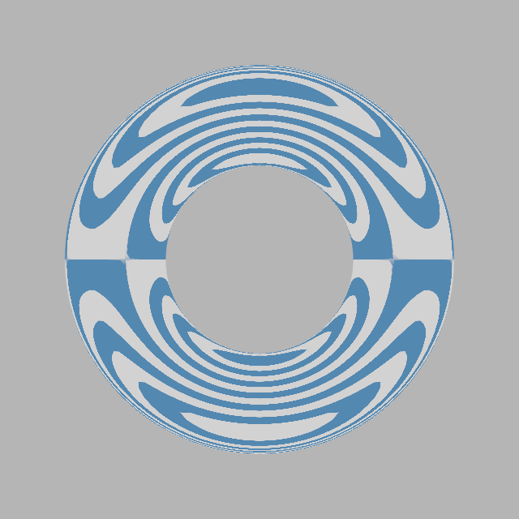

<!-- SPDX-License-Identifier: AGPL-3.0-only -->
# Zebra reference comparison — November 2, 2026

## Result

The sphere and torus now reproduce the reference's blue/grey lobes and stripe
orientation closely. Camera dolly and pan no longer change the reflected
pattern. Notes can still be written, pinned, saved and reopened with Zebra
enabled. This is a bounded visual comparison, not a claim of pixel equality on
every model or a geometric continuity certificate.

Reference application: installed **Revo Design Pro 8.0.123** (QuickSurface
executable), operated through its native UI. Target: this plugin in
`mrhz1973/tmar-scan-desktop`, branch `codex/zebra-qs-parity`, rebased onto
`f8030e10d5f40632c24b9d4ca517c2e6135b3ae8` (PR #5). The recorded before-image
baseline is `cc6ea7e733ef840f01791a2d822ef72bf0a5029f`. No host/viewer/kernel/note code was
changed. Existing SurfaceLab research supplied the reflection equation;
this increment used no new decompilation.

## What changed

- Compute reflection texture coordinates per vertex, then interpolate them
  across triangles. Previously the nonlinear reflection was calculated per
  fragment using interpolated view-space positions/normals.
- Centre the virtual eye/environment on the visible inspected geometry and
  use `0.6 * bounding-box diagonal` for its distance. CAD no longer borrows a
  radius from an unrelated scan. Camera translation is excluded; view rotation
  is retained.
- Share the visible CAD frame when applying stripes only to selected bodies.
  Hidden bodies do not enlarge that frame. Cache local bounds by position
  attribute identity/version while keeping transforms live.
- Preserve the existing grey `210,210,210`, blue `83,136,177`, 1024-square
  pattern, orientation and width controls. Originals and picking are untouched.

## Native reference observations

`scripts/reference-fixtures.mjs` generates an analytical STEP sphere of radius
20 and a torus of major/minor radii 20/7. Only these generated fixtures were
opened in the reference application. No personal scan or project was used.

The reference slider was at its UI value 60 for the captured cases; target
stripe-width level 4 gives the matching band pattern. This is an empirical
match at that setting, not a calibration of every slider position. The target
retains its existing seven useful levels and default level 3.

On the sphere, Horizontal produces upper/lower nested lobes with the same
midline phase; Vertical moves them left/right. Reference zoom from about 241
to 147 pixels of sphere radius preserves those lobes. Turning Zebra off
restores the original shaded surface. The torus top view reproduces the same
nested bands on convex and concave portions.

The two applications tessellate the analytical fixtures independently. They
also have different viewport sizes, backgrounds and rasterization, so the
screenshots are visual evidence rather than a pixel-diff oracle.

| Native reference | Target rendering layer |
| --- | --- |
|  |  |
|  |  |
|  |  |

[Reference sphere after zoom](qs-sphere-zoomed.jpg) records the second zoom
level. The target images come from the actual `ZebraLayer` rendered in WebGL,
not a mock image or a separately implemented shader.

The recorded target [before the change](before-horizontal.png) and
[after a dolly with the old layer](before-dolly.png) show the previous
camera-dependent bands. The current horizontal render above remains unchanged
under that same dolly, as measured below.

## Measured regressions and checks

`scripts/check-reflection.mjs` renders at 640 × 640. A pixel is counted as
changed when the sum of absolute RGB channel differences exceeds 6. The
percentages below use the **whole canvas**, including its background. They
measure stability between target renders, **not similarity to QS**.

| Action | Before | Current |
| --- | ---: | ---: |
| Dolly camera Z from 100 to 500, same orthographic projection | 7.0847% | 0% |
| Translate sphere and camera together | 0% | 0% |
| Select the sole visible body | 0% | 0% |
| Change horizontal to vertical | 23.0237% | 22.9951% |
| Rotate view around torus | 24.0249% | 24.5496% |
| Remove Zebra while viewing only a back face | 0% | 0% |

An additional current-only check makes a distant second body visible: the
frame changes (22.9822% of canvas pixels). Switching between selected-only
and all visible bodies does not shift that common frame (0%). Hiding the
second body restores the original pattern exactly (0%). Raw measurements:
[before](before-measurements.json), [current](current-measurements.json).

| Check | Outcome |
| --- | --- |
| TypeScript (`node node_modules/typescript/bin/tsc --noEmit`) | PASS |
| Vite production build (`node node_modules/vite/bin/vite.js build`) | PASS; externalized Node-module and large-chunk warnings |
| Plugin unit checks (`node node_modules/vitest/vitest.mjs run plugins/tmar-zebra/tests/zebra.test.ts`) | PASS, 3 tests |
| Plugin boundary and unit policy | PASS |
| WebGL reflection/frame check | PASS, no console errors |
| Full-app `e2e-zebra.mjs` on the updated base | PASS, all 32 assertions; no console errors |

The full-app check covered scan/CAD notes without an agent connection, notes
while Zebra stays visible, source-material preservation, target/visibility
changes, clipping, CAD-editor and workspace exit, comparison after Zebra,
project save/reopen, retained notes and a host build without plugins. After
rebasing, five further assertions verify the lower button's shared state,
automatic scan targeting, disabled state during editing, and real note-focus
rings centred in the viewport for both scan and CAD notes with Zebra active.
The extended check and TypeScript/production build were rerun because of the
new integration base; unchanged layer/unit checks were not repeated. It ran
with Node 26.8.1 and Chrome 156.0.8078.74 on Windows. Windows delayed removal
of its isolated temporary browser profile; the test reported an `EPERM`
cleanup warning after all assertions passed.

The local npm wrapper initially exited without running the build/test tools;
the same installed tools were run directly with Node as listed above. The
browser checks used isolated temporary profiles and locally owned servers,
not the owner's open sessions. Windows could not launch the isolated browser
in the restricted execution environment; the authorized normal local test
run then completed successfully. The owner's ports 17492–17494 were untouched.

## Limits and handoff

- A real noisy scan, all reference slider positions, multiple CAD-body
  reference-app framing and every perspective angle were not visually
  qualified against QS. Arbitrary tessellation/GPU pixel equality is unproven.
- No macOS test, desktop-package release or broad unrelated host regression
  was run. Production source build passed; native reference inspection and
  target browser verification are separate evidence.
- This branch is for a draft PR. The coordinating ScanRuler Desktop chat
  retains integration/release ownership; its working copies and servers
  remain untouched. SurfaceLab work remains paused.

For a quick review: compare the sphere and torus above, zoom and rotate a
body with Zebra on, switch orientation, then use **Add note on the part** and
save/reopen the project. The note must remain available, and switching Zebra
off must restore the original shading.
